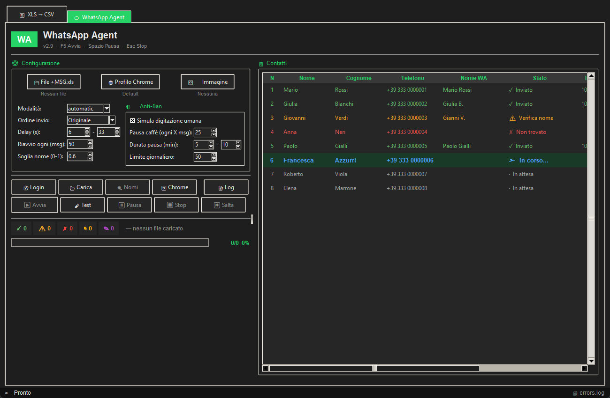
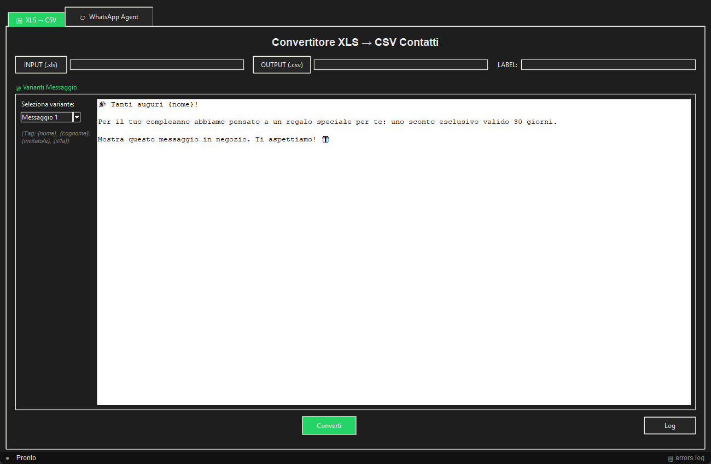

# WhatsApp Toolkit

**[🇮🇹 Italiano](#italiano) | [🇬🇧 English](#english)**

> ⚠️ **Repository di presentazione.** Il codice sorgente è proprietario e non è pubblicato. Questa pagina descrive le funzionalità del prodotto.
> **Showcase repository.** The source code is proprietary and not published. This page describes the product's features.

---

## 🇮🇹 Italiano

**Messaggi WhatsApp personalizzati ai tuoi clienti, in automatico, con il controllo di una persona.**

WhatsApp Toolkit è un'applicazione desktop pensata per negozi, centri ottici, studi professionali e piccole attività. Trasforma l'elenco clienti in una campagna di messaggi personali (auguri di compleanno, promozioni, inviti a eventi) e li invia uno alla volta, come faresti tu, senza copia-incolla e **senza costi per singolo messaggio**.

### Cosa fa

#### 1. Prepara la campagna
Carichi il file Excel esportato dal tuo gestionale. Il convertitore:

- pulisce e normalizza nomi, numeri di telefono e indirizzi;
- segnala subito i contatti con nome o cognome mancante;
- conserva il consenso privacy di ogni cliente;
- genera il file contatti pronto per Google Contacts;
- crea il messaggio personalizzato per ogni cliente.

Puoi scrivere **fino a 10 varianti** dello stesso messaggio, distribuite in modo uniforme tra i contatti.

| Tag | Esempio |
|-----|---------|
| `{nome}` | Mario |
| `{cognome}` | Rossi |
| `{invitato/a}` | invitato / invitata |
| `{il/la}` | il / la |

Il genere viene riconosciuto dal nome e il testo si accorda da solo.

#### 2. Invia i messaggi (testo e immagini)
- **Modalità automatica** o **manuale** (approvi ogni messaggio).
- **Testo + immagine**: locandina, coupon o foto prodotto con didascalia.
- **Controllo del destinatario**: se il nome su WhatsApp non corrisponde, chiede conferma.
- **Ripresa automatica**: dopo un'interruzione riparte dal punto esatto, senza doppi invii.
- **Modalità test** sul tuo numero prima di partire.

#### 3. Conformità GDPR e liste di esclusione
- Salta in automatico i contatti senza consenso.
- **Lista Opt-Out permanente**: chi chiede STOP non riceve più messaggi.
- **Lista chat personali**: famiglia, amici e gruppi esclusi con un clic, mai letti né toccati.
- **Storico multi-mese**: avvisa se un contatto è stato già scritto di recente o non è su WhatsApp.
- **Recap di fine sessione**: % di invio, % di risposte, follow-up per i colleghi, export Excel dei contatti da sistemare.

#### 4. Invio prudente
Ritmo umano: pause casuali, digitazione simulata, pause lunghe periodiche, limite giornaliero regolabile.

#### 5. Assistente risposte con IA locale (approvazione umana)
- Legge i messaggi in arrivo e propone una bozza di risposta.
- **Pipeline multi-agente su modello locale**: classifica il messaggio (STOP / domanda / ringraziamento), scrive la bozza usando FAQ e catalogo prodotti, e un revisore controlla che non inventi prezzi, disponibilità o orari.
- **I dati restano sul tuo computer**: nessun servizio cloud di IA.
- Pulsanti rapidi direttamente nella chat di WhatsApp Web.
- **Nessun invio automatico**: ogni bozza passa dalla tua approvazione.

#### 6. Versione API ufficiale (opzionale)
Per volumi elevati è disponibile un backend su **WhatsApp Cloud API** ufficiale (Meta / 360dialog).

### Casi d'uso
- Auguri di compleanno con sconto dedicato
- Inviti a eventi e presentazioni di prodotto
- Promemoria appuntamenti e ritiri
- Promozioni stagionali ai clienti fidelizzati
- Risposte rapide alle domande dei clienti su prodotti e disponibilità

### Requisiti
- Windows 10/11, oppure Raspberry Pi 4 / Linux
- Un account WhatsApp attivo
- Elenco clienti in formato Excel
- Opzionale: un modello IA locale per l'assistente risposte

### Licenza, demo e contatti
Software proprietario. **Tutti i diritti riservati.** Vedi [LICENSE](LICENSE).

Per una **demo**, una **licenza** o una **versione personalizzata** per la tua attività:
💬 Apri una [Issue](https://github.com/VicDc/WhatsApp-Toolkit-Showcase/issues) oppure scrivimi dal mio profilo GitHub: [@VicDc](https://github.com/VicDc)

### Uso responsabile
Invia messaggi solo a clienti che hanno dato il consenso (GDPR). WhatsApp non è affiliato a questo prodotto. L'uso di strumenti di automazione può violare i Termini di servizio di WhatsApp e portare alla sospensione del numero.

---

## 🇬🇧 English

**Personalized WhatsApp messages to your customers, automatically, with human-in-the-loop control.**

WhatsApp Toolkit is a desktop application for retail stores, optical shops, professional practices and small businesses. It turns your customer list into a personalized campaign (birthday wishes, promotions, event invitations) and sends messages one by one, like you would, with no copy-paste and **no per-message fees**.

### Features

1. **Campaign preparation**: imports the Excel export of your management software, cleans names, phone numbers and addresses, keeps privacy consent, flags missing names, and builds a personalized message per customer. Up to **10 message variants** with gender-aware tags (`{nome}`, `{cognome}`, `{invitato/a}`, `{il/la}`).
2. **Sending (text and images)**: automatic or manual mode, image + caption, recipient name check, automatic resume without duplicates, test mode on your own number.
3. **GDPR compliance**: skips contacts without consent, permanent opt-out list, personal-chat exclusion list, multi-month history, end-of-session recap with reply rate and follow-ups.
4. **Human-like pacing**: random delays, simulated typing, periodic long breaks, daily cap.
5. **Local AI reply assistant**: multi-agent pipeline on a local model (classifier, responder with FAQ and product catalog, reviewer that blocks invented prices or stock). Data stays on your machine. **Every reply needs your approval.**
6. **Official API edition (optional)**: WhatsApp Cloud API backend (Meta / 360dialog) for high volumes.

### Requirements
Windows 10/11 or Raspberry Pi 4 / Linux, an active WhatsApp account, a customer list in Excel. Optional: a local AI model for the reply assistant.

### License, demo and contact
Proprietary software. **All rights reserved.** See [LICENSE](LICENSE).

For a **demo**, a **license** or a **custom version** for your business:
💬 Open an [Issue](https://github.com/VicDc/WhatsApp-Toolkit-Showcase/issues) or reach me via my GitHub profile: [@VicDc](https://github.com/VicDc)

### Responsible use
Only message customers who gave consent (GDPR). WhatsApp is not affiliated with this product. Automation tools may violate WhatsApp's Terms of Service and can lead to number suspension.
